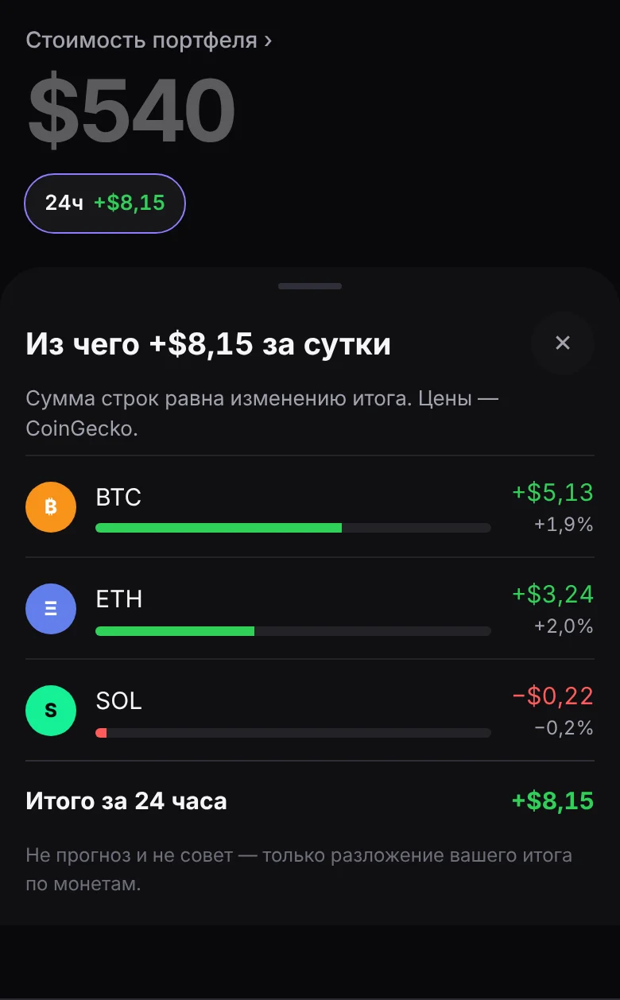
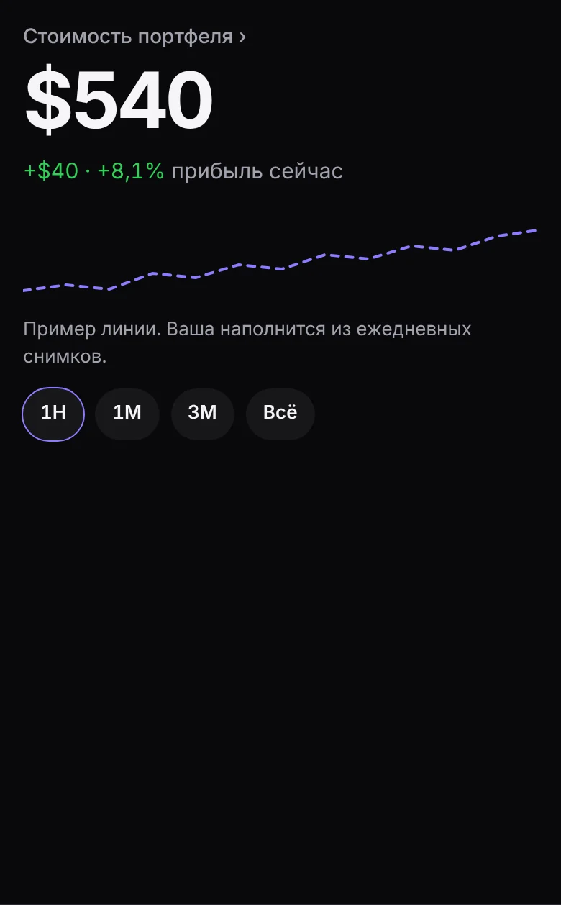
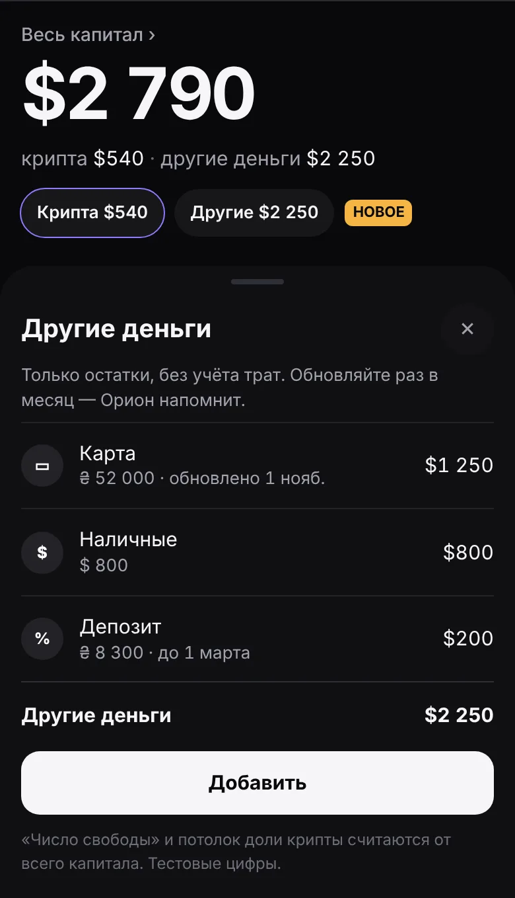

# BACKLOG — оценённые улучшения

Версия 1.1 — 18.11.2026 (+ пункты 16–20 после сверки с инструкцией проекта). Это **отобранный и оценённый** список: из него автономный цикл берёт ОДНУ задачу за запуск.
Сырые находки (охоты на ошибки, разборы конкурентов, 92 открытых пункта) — в `agent/BACKLOG.md` (ветка `agent`);
лучшее оттуда переносится сюда с оценкой.

**Как оценено.** Ценность для пользователя, сложность и риск — от 1 до 5.
**Приоритет = Ценность × 2 − Сложность − Риск** (чем больше, тем раньше). Уровень — по RULES.md: 🟢 сами · 🟡 ждём «ок».
Макеты — `ai-ops/mockups/` (исходник `mockups.html`, только тестовые цифры).

## Сводка

| # | Улучшение | Ценность | Сложн. | Риск | Приоритет | Уровень | Вид |
|---|---|---|---|---|---|---|---|
| 1 | «Удали заметку про X» удаляет не ту заметку | 5 | 2 | 2 | **6** | 🟢 | Орион |
| 2 | «Дела Ориона» портят записи человека на украинском | 4 | 1 | 1 | **6** | 🟢 | Орион |
| 3 | Лестница без резерва: «нет бюджета» вместо «куплено ✓ $0,00» | 5 | 2 | 3 | **5** | 🟡 | макет M4 |
| 4 | Украинский у Ориона без суржика (~25 фраз) | 4 | 2 | 1 | **5** | 🟢 | Орион |
| 5 | Строка безопасности в Настройках | 3 | 1 | 1 | **4** | 🟢 | макет M3 |
| 6 | Итог портфеля в BTC одним нажатием | 4 | 2 | 2 | **4** | 🟡 | макет M1 |
| 7 | Орион: «оповещение DOGE, 0 долларов» → точная цена | 3 | 1 | 1 | **4** | 🟢 | Орион |
| 8 | «Из чего 24ч» — изменение за сутки по монетам | 4 | 3 | 2 | **3** | 🟡 | макет M2 |
| 9 | Демо: пример линии графика вместо пустоты | 3 | 2 | 1 | **3** | 🟢 | макет M5 |
| 10 | Пустая сумма в правке пополнения — резерв и DCA считают старое | 4 | 2 | 3 | **3** | 🟡 | — |
| 11 | Единый тон интерфейса «вы» | 3 | 2 | 1 | **3** | 🟡 | решение |
| 16 | Деньги точно: тесты-«сторожа» на все суммы, новый код — в целых центах | 4 | 3 | 2 | **3** | 🟢 | невидимо |
| 20 | Орион: лёгкий юмор Джарвиса (по инструкции), без шуток в тяжёлые дни | 3 | 2 | 1 | **3** | 🟢 | Орион |
| 12 | «План месяца» у Ориона = весь неистраченный бюджет DCA | 4 | 3 | 3 | **2** | 🟡 | Орион |
| 17 | Согласие: фразы с вашими суммами — живым голосом (ElevenLabs) или голосом телефона | 3 | 2 | 2 | **2** | 🟡 | Настройки |
| 18 | «Другие деньги»: карты, наличные, депозиты одной суммой (вариант Б) | 4 | 3 | 3 | **2** | 🟡 ❓ | макет M6 |
| 13 | Ввод текстом в «Дела Ориона» (без микрофона) | 3 | 3 | 2 | **1** | 🟡 | — |
| 14 | Хвосты «Графита»: свечения и радуга в Достижениях, ореол логотипов | 2 | 2 | 1 | **1** | 🟢 | — |
| 15 | «Наценка к рынку» в покупках | 3 | 4 | 3 | **−1** | 🟡 | — |
| 19 | Все тексты — в файлы перевода (сейчас русский прямо в коде) | 1 | 4 | 2 | **−4** | 🟢 | невидимо |

---

## Карточки

### 1 · «Удали заметку про X» удаляет не ту заметку — 🟢
- **Зачем:** голосовая команда стирает **последнюю** заметку, а «отмени напоминание про биржу» снимает **все** — это потеря данных человека.
- **Пример:** человек говорит «Орион, удали заметку про налоги» → сейчас исчезает заметка «купить ETH в пятницу»; после — исчезает именно «налоги», остальные на месте.
- **Где:** `mascot.js` ~1111, 1117. Тест «из трёх снимается одно». Источник: охота 18.11, #3.

### 2 · «Дела Ориона» портят записи на украинском — 🟢
- **Зачем:** словарь перевода меняет текст, который написал сам человек.
- **Пример:** заметка «Купить BTC після зарплати» → на экране превращается в смесь языков; после — показывается ровно как записано.
- **Где:** `plus.js` ~638, добавить `translate="no"` (1 строка). Охота 18.11, #2.

### 3 · Лестница без резерва — 🟡 (показ меняется, расчёт — нет)

- **Зачем:** при резерве $0 все ступени выглядят **купленными** («куплено ✓ $0,00») — пугает и вводит в заблуждение.
- **Пример:** человек открывает «Стратегию» с пустым резервом → видит «нет бюджета» и кнопку «Пополнить резерв».
- **Почему 🟡:** это функция владельца (лестница); сам расчёт не трогаем — только надпись. Охота 16.11, #1.

### 4 · Украинский у Ориона без суржика — 🟢
- **Зачем:** этапы 4–5 Ориона добавили ~25 фраз без перевода — в субтитрах и голосе смесь языков.
- **Пример:** «Нагадаю завтра о 9:00» вместо смеси русского и украинского. До/после — таблицей фраз в PR + запись голоса.
- **Где:** `i18n.js`, `mascot.js` (`spokenUk`). Охота 18.11, #1.

### 5 · Строка безопасности в Настройках — 🟢

- **Зачем:** у конкурентов (CoinStats, отзывы 1★) люди путают трекер с биржей и попадаются мошенникам «от имени приложения».
- **Пример:** открывает «Настройки» → первой видит карточку «Ваши деньги — не у нас…». Только текст, RU/UA. Разбор конкурентов 16.11.

### 6 · Итог портфеля в BTC — 🟡 (новая функция с интерфейсом)

- **Зачем:** стратегия владельца построена вокруг BTC; Kubera и другие показывают портфель в BTC.
- **Пример:** нажимает чип «≈ 0,00491 BTC» → итог $540 становится 0,00491 BTC; выбор запоминается на телефоне. Расчёты денег не меняются.

### 7 · Орион: «оповещение DOGE, 0 долларов» — 🟢
- **Пример:** «Поставь оповещение DOGE по 12 центов» → сейчас Орион отвечает «0 долларов»; после — «0,12 доллара».
- **Где:** `mascot.js` ~1094: `Math.round` → уже есть `priceW`. 1 строка. Охота 18.11, #4.

### 8 · «Из чего 24ч» — 🟡

- **Зачем:** в отзывах Delta и CoinStats жалуются «не понимаю, откуда цифры».
- **Пример:** нажимает чип «24ч +$8,15» → шторка: BTC +$5,13, ETH +$3,24, SOL −$0,22, итого +$8,15. Не прогноз — только разложение.

### 9 · Демо: пример линии графика — 🟢

- **Зачем:** новичок в демо видит под суммой ~70 px пустоты (скриншот `screens/01-glavnaya-dark-390.webp`) — первое впечатление.
- **Пример:** открывает демо → пунктирная линия «Пример. Ваша наполнится из ежедневных снимков». Только в демо.

### 10 · Пустая сумма в правке пополнения — 🟡
- **Зачем:** в «Истории» «—», а резерв и DCA считают старую сумму — цифры расходятся.
- **Почему 🟡:** затрагивает то, как считаются резерв и DCA. Сначала разобрать, затем макет владельцу. Охота 16.11, #6.

### 11 · Единый тон «вы» — 🟡 (нужно решение владельца)
- **Пример:** «Впиши сумму больше нуля» → «Впишите сумму больше нуля». Орион уже говорит на «вы». Охота 15.11, #13.

### 12 · «План месяца» у Ориона — 🟡
- **Пример:** Орион говорит «осталось купить на 761 доллар», хотя план месяца — $100; сервер будет каждый месяц слать «План не выполнен». Касается смысла DCA — показать владельцу варианты.

### 13 · Ввод текстом в «Дела Ориона» — 🟡
- Без распознавания речи (часть браузеров) функции этапа 4 недоступны: нет поля «Добавить». Новый элемент интерфейса — сначала макет.

### 14 · Хвосты «Графита» — 🟢
- Полоса и значки «Достижений» с радугой и свечением, ореол логотипов монет, легенда графика с градиентом, **оранжевое свечение лицевой карточки монеты** (`screens/09-moneta-dark-390.webp`) — по правилу VISUAL_GUIDE п. 6. До/после — скриншоты.

### 15 · «Наценка к рынку» — 🟡
- Средняя переплата к дневной цене CoinGecko в карточке монеты, «оценка, не точная комиссия». Новый показатель, 6–8 ч, нужна история цен.

### 16 · Деньги точно — 🟢 (шаг 1), 🟡 (шаг 2)
- **Зачем:** инструкция требует точные типы денег. Сейчас суммы — дробные числа JavaScript с погрешностью (0,1 + 0,2 = 0,30000000000000004); округление прячет её при показе, но на годах записей копейки могут разойтись.
- **Шаг 1 (🟢, невидимо):** тесты-«сторожа» с точностью до цента на итог, прибыль, доли, резерв, ступени лестницы, DCA и курс гривны; новый код считает в целых центах. Расчёты не меняются — только проверяются.
- **Шаг 2 (🟡):** перевод существующих расчётов на центы — по одному расчёту, каждый с вашим «ок», потому что это расчёты денег.

### 17 · Согласие на живой голос с вашими суммами — 🟡 (приватность)
- **Зачем:** фразы Ориона с вашими суммами отправляются текстом в ElevenLabs, чтобы озвучить. По инструкции данные пользователя уходят третьим сервисам только с согласия.
- **Пример:** «Настройки» → «Орион» → переключатель «Мои суммы — живым голосом». Выключено → такие фразы звучат голосом телефона, без отправки. Плюс строка в политике конфиденциальности (RU/UK).

### 18 · «Другие деньги» — 🟡, ждёт решения «что такое MoneyLife» (PRODUCT_VISION, п. 1)

- **Зачем:** инструкция называет приложение учётом личных финансов (карты, наличные). Вариант Б даёт картину всего капитала без учёта трат — «Число свободы» и потолок доли крипты становятся точнее.
- **Пример:** открывает Главную → видит «Весь капитал $2 790» → нажимает «Другие $2 250» → шторка: Карта ₴ 52 000, Наличные $800, Депозит → «Добавить». Раз в месяц Орион напоминает обновить остатки.
- **Почему 🟡:** новый экран, новые данные в базе (только новое необязательное поле), смысл «Число свободы» меняется — всё после вашего выбора варианта и «ок» на макет.

### 19 · Тексты в файлы перевода — 🟢, потихоньку
- Сейчас русский написан прямо в коде, украинский подставляется словарём `i18n.js`. Инструкция просит держать все тексты в файлах перевода. Переносить по одному экрану, когда агент и так меняет этот экран; тест «Украинский язык» должен оставаться зелёным.

### 20 · Орион: лёгкий юмор — 🟢
- **Зачем:** инструкция (18.11): «лёгкий ненавязчивый юмор в стиле Джарвиса; без шуток, когда человек расстроен или тема серьёзная».
- **Пример:** спокойный день, человек спрашивает «как биткоин?» → «Биткоин сегодня скучает: плюс 0,3 процента. Я бы на его месте тоже отдохнул.» При просадке −10% или убытке — только спокойно и по делу, без шуток.
- **Как проверить:** тест: при настроении «down» и антипанике в ответах нет шутливых фраз; не чаще одной шутки на 4–5 ответов.
