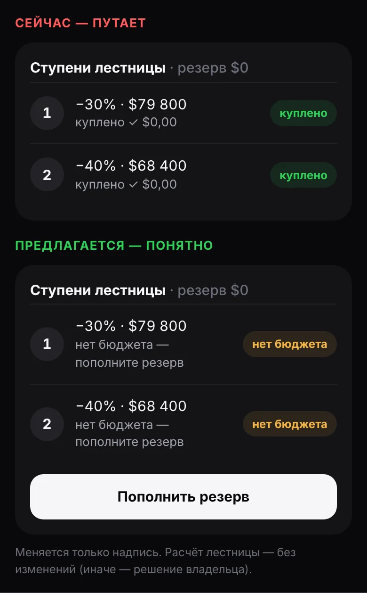
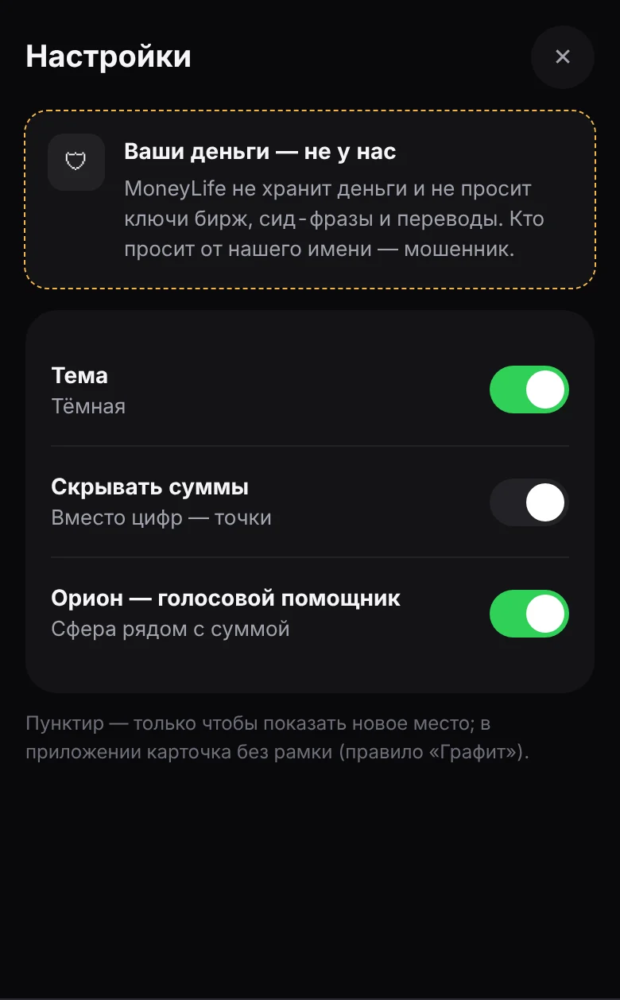
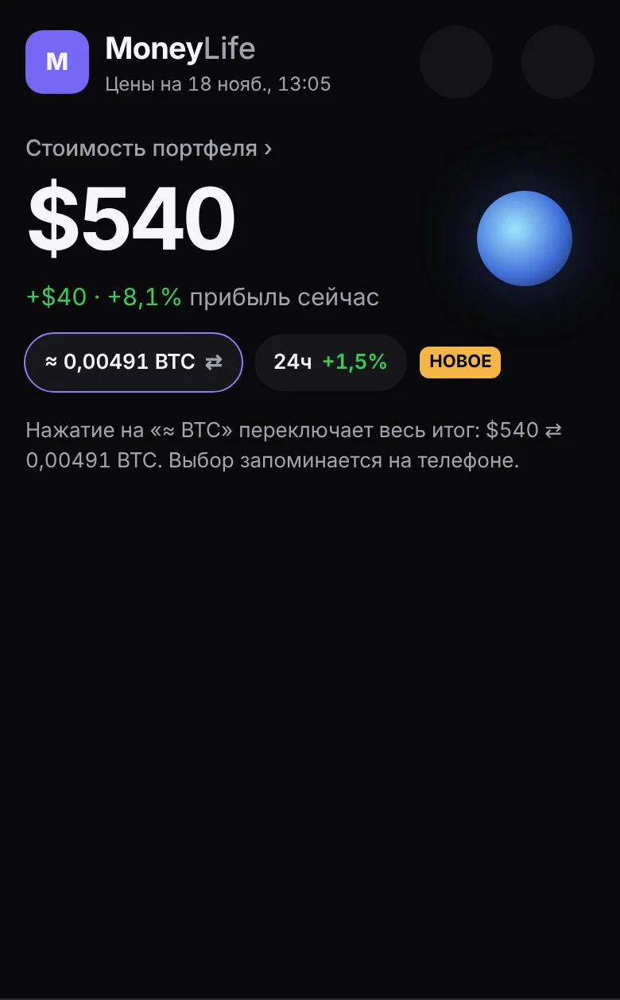

# BACKLOG — оценённые улучшения

Версия 1.2 — 18.11.2026. С 18.11 владелец только наблюдает: 🟡 тоже делаем сами (строже, RULES.md), 🛑 — не делаем.
Пункты И1–И8 — инфраструктура Этапа 2, идут **первыми** (без страховки остальное рискованно). Это **отобранный и оценённый** список: из него автономный цикл берёт ОДНУ задачу за запуск.
Сырые находки (охоты на ошибки, разборы конкурентов, 92 открытых пункта) — в `agent/BACKLOG.md` (ветка `agent`);
лучшее оттуда переносится сюда с оценкой.

**Как оценено.** Ценность для пользователя, сложность и риск — от 1 до 5.
**Приоритет = Ценность × 2 − Сложность − Риск** (чем больше, тем раньше). Уровень — по RULES.md: 🟢 сами · 🟡 ждём «ок».
Макеты — `ai-ops/mockups/` (исходник `mockups.html`, только тестовые цифры).

## Сводка

| # | Улучшение | Ценность | Сложн. | Риск | Приоритет | Уровень | Вид |
|---|---|---|---|---|---|---|---|
| 1 | «Удали заметку про X» удаляет не ту заметку — PR №12 открыт, осталось «ключи» ≠ «ключевые» | 5 | 2 | 2 | **6** | 🟢 | Орион |
| 2 | «Дела Ориона» портят записи человека на украинском | 4 | 1 | 1 | **6** | 🟢 | Орион |
| 3 | Лестница без резерва: «нет бюджета» вместо «куплено ✓ $0,00» | 5 | 2 | 3 | **5** | 🟡 | макет M4 |
| 4 | Украинский у Ориона без суржика (~25 фраз) | 4 | 2 | 1 | **5** | 🟢 | Орион |
| 5 | Строка безопасности в Настройках | 3 | 1 | 1 | **4** | 🟢 | макет M3 |
| 6 | Итог портфеля в BTC одним нажатием | 4 | 2 | 2 | **4** | 🟡 | макет M1 |
| 7 | Орион: «оповещение DOGE, 0 долларов» → точная цена | 3 | 1 | 1 | **4** | 🟢 | Орион |
| 8 | «Из чего 24ч» — изменение за сутки по монетам | 4 | 3 | 2 | **3** | 🟡 | макет M2 |
| 9 | Демо: пример линии графика вместо пустоты | 3 | 2 | 1 | **3** | 🟢 | макет M5 |
| 10 | Пустая сумма в правке пополнения — резерв и DCA считают старое | 4 | 2 | 3 | **3** | 🟡 | — |
| 11 | Единый тон интерфейса «вы» (решено 18.11) | 3 | 2 | 1 | **3** | 🟡 | — |
| 16 | Деньги точно: тесты-«сторожа» на все суммы, новый код — в целых центах | 4 | 3 | 2 | **3** | 🟢 | невидимо |
| 20 | Орион: лёгкий юмор Джарвиса (по инструкции), без шуток в тяжёлые дни | 3 | 2 | 1 | **3** | 🟢 | Орион |
| 12 | «План месяца» у Ориона = весь неистраченный бюджет DCA | 4 | 3 | 3 | **2** | 🟡 | Орион |
| 17 | Согласие: фразы с вашими суммами — живым голосом (ElevenLabs) или голосом телефона | 3 | 2 | 2 | **2** | 🟡 | Настройки |
| 18 | «Другие деньги»: карты, наличные, депозиты одной суммой (вариант Б, выбран 18.11) | 5 | 3 | 3 | **4** | 🟡 | макет M6 |
| 13 | Ввод текстом в «Дела Ориона» (без микрофона) | 3 | 3 | 2 | **1** | 🟡 | — |
| 14 | Хвосты «Графита»: свечения и радуга в Достижениях, ореол логотипов | 2 | 2 | 1 | **1** | 🟢 | — |
| 15 | «Наценка к рынку» в покупках | 3 | 4 | 3 | **−1** | 🟡 | — |
| 19 | Все тексты — в файлы перевода (сейчас русский прямо в коде) | 1 | 4 | 2 | **−4** | 🟢 | невидимо |

---

## Этап 2 — инфраструктура (идёт первой)

| # | Что | Как (бесплатно, без передачи данных третьим) | Статус |
|---|---|---|---|
| И1 | Проверки на каждый PR | GitHub Actions «Проверки PR»: все автотесты + скриншоты 390/360, обе темы — файлами к PR | ✅ 18.11 |
| И2 | Кнопка «стоп» | «стоп» в чате → задача выключается; файл `ai-ops/STOP` → смена сразу завершается | ✅ 18.11 |
| И3 | Ночной бэкап базы | функция в своём Supabase: копия таблицы `docs` в отдельную таблицу-архив раз в сутки, 7 последних копий; SQL отката | ✅ 19.11 (PR №13, схема `moneylife_backup`, первый снимок 237 = 237) |
| И4 | Мониторинг ошибок | ошибки JS у пользователей → своя таблица в Supabase (без сумм и имён); счётчик в дайджесте | ждёт |
| И5 | Staging | вторая копия сайта из ветки `staging` (способ выбрать: подпапка `/staging/` через сборку Pages в Actions или бесплатный хостинг без передачи данных); агент проверяет там перед выкладкой | ждёт |
| И6 | Автооткат | после выкладки — Actions открывает живой сайт, проходит ключевые сценарии; провал или рост ошибок → `git revert` | ждёт |
| И7 | Лимит бюджета | дневной потолок запросов к «мозгу» Ориона (Anthropic) и голосу (ElevenLabs) на сервере; превышение → голос телефона и короткий ответ | ждёт |
| И8 | Видео сценариев | запись экрана ключевых сценариев (Playwright, webm → GIF) к PR и в недельный обзор | ждёт |

## Новые задачи владельца 24.11 (Н1–Н10)

Добавлены 24.11 без смены порядка старых пунктов. Главный приоритет владельца: **сначала идеальное качество, потом рынок.**
Ответы теста 24.11 — в DECISIONS.md. **Порядок (решение 0.1 A):** баги Н2–Н4 и ускорение Н5а — **сразу после И4** (PR №16), до И5–И8.
Визуальные задачи (Н3-вид, Н5б, Н8, Н9, Н10, брифинг Н7): минимум 5 разных вариантов с макетами, по 1–2 задачи за раз, выбор владельца — **сменам не брать**.

| # | Задача | Причина (проверено 24.11) | Что делать | Готово, когда | Статус |
|---|---|---|---|---|---|
| Н3 | «План альткоинов» не прокручивается, видны только июнь–август | ✅ `.fold-b{display:grid}` без ширины колонки: колонка растягивается под 19 карточек — 2272 px вместо 308; лента не прокручивается, правое обрезано (и текст под ней тоже). Данные в базе есть: 19 месяцев, план утверждён | `.fold-b{grid-template-columns:minmax(0,1fr)}` в стилях складок + тест «ни одна складка не шире экрана» + тест «план прокручивается, текущий месяц виден» | на 360 и 390 px видна карточка текущего месяца, лента листается до дек 2027, текст под лентой не обрезан | 🟢 чинить первым |
| Н2 | График монеты появляется через 1–3 с | ✅ история цены берётся из сети при каждом открытии, если сохранённой копии больше 1 ч (6 ч для года); старая копия показывается **только при ошибке**. Замер (эмуляция сети 0,6 / 1,5 с): 661 / 1552 мс; с копией младше часа — 8 мс | показывать сохранённую копию сразу и тихо обновлять в фоне (`cached()` в `shim.js`); через 3 с после запуска заранее подгружать графики монет портфеля | график ≤ 300 мс при любом открытии, кроме самого первого в жизни приложения (10 замеров) | 🟢 |
| Н4 | Орион обрывает фразы в субтитрах | ✅ сервер `orion-ask` режет ответ на **600 знаках** — посреди слова (`full.length < 600`, `.slice(0, 600)`); доп.: приложение обрывает поток через 25 с, а продолжения старше 40 с выбрасывает из очереди | убрать резку посреди фразы: предел ~1500 знаков и только по концу предложения; 25 с → 45 с для потока; «продолжения» не выбрасывать; если связь оборвалась после начала — честно сказать «связь прервалась» | 0 обрывов на 50 тестовых вопросах (RU/UA, короткие и длинные), автотест на ответ 900 знаков | 🟢 (после PR №12) |
| Н5а | Долго после «Секунду» | ✅ логи Supabase 23–24.11: озвучка `orion-voice` p50 **2,7 с**, p90 5,5 с, макс 7,8 с; ответ `orion-ask` p50 0,9 с, p90 6,2 с; субтитры ждут звук до 4 с. Цепочка последовательная: ответ → первое предложение ≥ 60 знаков → озвучка целиком → звук | субтитры сразу, звук догоняет; первый кусок для озвучки короче (одно предложение); озвучка потоком ElevenLabs (`/stream`), если подтвердится; замер этапов `Server-Timing` в `orion-ask` | индикатор ≤ 100 мс; первое слово ≤ 2 с (решение 5.2 B) в 8 из 10 вопросов | 🟢 после Н4 |
| Н1 | Белый квадрат 1–2 с при запуске (приложение с главного экрана, тёмная тема) | ⏳ в тестовом браузере **не повторился**: 147 кадров запуска, белых областей нет; иконка и заставка тёмные. Нужна запись экрана с телефона владельца | после записи — найти элемент, исправить, проверить скриптом кадров | 0 появлений на 20 запусках подряд | ⏸ ждёт видео |
| Н5б | Индикатор «думаю»: вид + тихий звук | — | 5 вариантов макетов → выбор владельца | индикатор ≤ 100 мс после вопроса | ⏸ варианты |
| Н6 | Живой диалог, перебивание голосом | — | после Н4/Н5; решения 6.1–6.3 | 10 мин разговора без сбоя; перебивание ≤ 0,5 с | ⏸ |
| Н7 | «Суперразум» | — | сначала архитектура и расчёт 2–3 вариантов цены (решение 7.1 D) | — | ⏸ расчёт |
| Н8 | Индекс страха и жадности на Главной сверху, мягкая анимация | — | 5 вариантов | Вера и Глеб «да», 60 кадров/с, «Уменьшить движение» | ⏸ варианты |
| Н9 | Бейджи «Лидеры дня» (% + мини-график за сутки) и «Распределение» | — | 5 вариантов | читается на 360 px, контраст ≥ 4,5:1 | ⏸ варианты |
| Н10 | График монеты: покупки, продажи, средняя цена, зелёная/красная зона, по месяцам | — | 5 вариантов (после Н2) | средняя цена = «Монеты» до цента; 100 покупок без тормозов | ⏸ варианты |

## Карточки

### 1 · «Удали заметку про X» удаляет не ту заметку — 🟢
- **Зачем:** голосовая команда стирает **последнюю** заметку, а «отмени напоминание про биржу» снимает **все** — это потеря данных человека.
- **Пример:** человек говорит «Орион, удали заметку про налоги» → сейчас исчезает заметка «купить ETH в пятницу»; после — исчезает именно «налоги», остальные на месте.
- **Где:** `mascot.js` ~1111, 1117. Тест «из трёх снимается одно». Источник: охота 18.11, #3.

### 2 · «Дела Ориона» портят записи на украинском — 🟢
- **Зачем:** словарь перевода меняет текст, который написал сам человек.
- **Пример:** заметка «Купить BTC після зарплати» → на экране превращается в смесь языков; после — показывается ровно как записано.
- **Где:** `plus.js` ~638, добавить `translate="no"` (1 строка). Охота 18.11, #2.

### 3 · Лестница без резерва — 🟡 (показ меняется, расчёт — нет)

- **Зачем:** при резерве $0 все ступени выглядят **купленными** («куплено ✓ $0,00») — пугает и вводит в заблуждение.
- **Пример:** человек открывает «Стратегию» с пустым резервом → видит «нет бюджета» и кнопку «Пополнить резерв».
- **Почему 🟡:** это функция владельца (лестница); сам расчёт не трогаем — только надпись. Охота 16.11, #1.

### 4 · Украинский у Ориона без суржика — 🟢
- **Зачем:** этапы 4–5 Ориона добавили ~25 фраз без перевода — в субтитрах и голосе смесь языков.
- **Пример:** «Нагадаю завтра о 9:00» вместо смеси русского и украинского. До/после — таблицей фраз в PR + запись голоса.
- **Где:** `i18n.js`, `mascot.js` (`spokenUk`). Охота 18.11, #1.

### 5 · Строка безопасности в Настройках — 🟢

- **Зачем:** у конкурентов (CoinStats, отзывы 1★) люди путают трекер с биржей и попадаются мошенникам «от имени приложения».
- **Пример:** открывает «Настройки» → первой видит карточку «Ваши деньги — не у нас…». Только текст, RU/UA. Разбор конкурентов 16.11.

### 6 · Итог портфеля в BTC — 🟡 (новая функция с интерфейсом)

- **Зачем:** стратегия владельца построена вокруг BTC; Kubera и другие показывают портфель в BTC.
- **Пример:** нажимает чип «≈ 0,00491 BTC» → итог $540 становится 0,00491 BTC; выбор запоминается на телефоне. Расчёты денег не меняются.

### 7 · Орион: «оповещение DOGE, 0 долларов» — 🟢
- **Пример:** «Поставь оповещение DOGE по 12 центов» → сейчас Орион отвечает «0 долларов»; после — «0,12 доллара».
- **Где:** `mascot.js` ~1094: `Math.round` → уже есть `priceW`. 1 строка. Охота 18.11, #4.

### 8 · «Из чего 24ч» — 🟡

- **Зачем:** в отзывах Delta и CoinStats жалуются «не понимаю, откуда цифры».
- **Пример:** нажимает чип «24ч +$8,15» → шторка: BTC +$5,13, ETH +$3,24, SOL −$0,22, итого +$8,15. Не прогноз — только разложение.

### 9 · Демо: пример линии графика — 🟢

- **Зачем:** новичок в демо видит под суммой ~70 px пустоты (скриншот `screens/01-glavnaya-dark-390.webp`) — первое впечатление.
- **Пример:** открывает демо → пунктирная линия «Пример. Ваша наполнится из ежедневных снимков». Только в демо.

### 10 · Пустая сумма в правке пополнения — 🟡
- **Зачем:** в «Истории» «—», а резерв и DCA считают старую сумму — цифры расходятся.
- **Почему 🟡:** затрагивает то, как считаются резерв и DCA. Сначала разобрать, затем макет владельцу. Охота 16.11, #6.

### 11 · Единый тон «вы» — 🟡 (нужно решение владельца)
- **Пример:** «Впиши сумму больше нуля» → «Впишите сумму больше нуля». Орион уже говорит на «вы». Охота 15.11, #13.

### 12 · «План месяца» у Ориона — 🟡
- **Пример:** Орион говорит «осталось купить на 761 доллар», хотя план месяца — $100; сервер будет каждый месяц слать «План не выполнен». Касается смысла DCA — показать владельцу варианты.

### 13 · Ввод текстом в «Дела Ориона» — 🟡
- Без распознавания речи (часть браузеров) функции этапа 4 недоступны: нет поля «Добавить». Новый элемент интерфейса — сначала макет.

### 14 · Хвосты «Графита» — 🟢
- Полоса и значки «Достижений» с радугой и свечением, ореол логотипов монет, легенда графика с градиентом, **оранжевое свечение лицевой карточки монеты** (`screens/09-moneta-dark-390.webp`) — по правилу VISUAL_GUIDE п. 6. До/после — скриншоты.

### 15 · «Наценка к рынку» — 🟡
- Средняя переплата к дневной цене CoinGecko в карточке монеты, «оценка, не точная комиссия». Новый показатель, 6–8 ч, нужна история цен.

### 16 · Деньги точно — 🟢 (шаг 1), 🟡 (шаг 2)
- **Зачем:** инструкция требует точные типы денег. Сейчас суммы — дробные числа JavaScript с погрешностью (0,1 + 0,2 = 0,30000000000000004); округление прячет её при показе, но на годах записей копейки могут разойтись.
- **Шаг 1 (🟢, невидимо):** тесты-«сторожа» с точностью до цента на итог, прибыль, доли, резерв, ступени лестницы, DCA и курс гривны; новый код считает в целых центах. Расчёты не меняются — только проверяются.
- **Шаг 2 (🟡):** перевод существующих расчётов на центы — по одному расчёту, каждый с вашим «ок», потому что это расчёты денег.

### 17 · Согласие на живой голос с вашими суммами — 🟡 (приватность)
- **Зачем:** фразы Ориона с вашими суммами отправляются текстом в ElevenLabs, чтобы озвучить. По инструкции данные пользователя уходят третьим сервисам только с согласия.
- **Пример:** «Настройки» → «Орион» → переключатель «Мои суммы — живым голосом». Выключено → такие фразы звучат голосом телефона, без отправки. Плюс строка в политике конфиденциальности (RU/UK).

### 18 · «Другие деньги» — 🟡, вариант Б выбран владельцем 18.11

- **Зачем:** инструкция называет приложение учётом личных финансов (карты, наличные). Вариант Б даёт картину всего капитала без учёта трат — «Число свободы» и потолок доли крипты становятся точнее.
- **Пример:** открывает Главную → видит «Весь капитал $2 790» → нажимает «Другие $2 250» → шторка: Карта ₴ 52 000, Наличные $800, Депозит → «Добавить». Раз в месяц Орион напоминает обновить остатки.
- **Почему 🟡:** новый экран и новые данные — новая коллекция записей в той же таблице `docs`, без изменения базы. «Число свободы» считается от всего капитала. Делаем сами, строгой цепочкой; первым шагом — после И1–И3.
- **Голосом:** «Орион, на карте 52 тысячи гривен» → обновляет остаток карты; трат не записывает.

### 19 · Тексты в файлы перевода — 🟢, потихоньку
- Сейчас русский написан прямо в коде, украинский подставляется словарём `i18n.js`. Инструкция просит держать все тексты в файлах перевода. Переносить по одному экрану, когда агент и так меняет этот экран; тест «Украинский язык» должен оставаться зелёным.

### 20 · Орион: лёгкий юмор — 🟢
- **Зачем:** инструкция (18.11): «лёгкий ненавязчивый юмор в стиле Джарвиса; без шуток, когда человек расстроен или тема серьёзная».
- **Пример:** спокойный день, человек спрашивает «как биткоин?» → «Биткоин сегодня скучает: плюс 0,3 процента. Я бы на его месте тоже отдохнул.» При просадке −10% или убытке — только спокойно и по делу, без шуток.
- **Как проверить:** тест: при настроении «down» и антипанике в ответах нет шутливых фраз; не чаще одной шутки на 4–5 ответов.

### Находки смены 19.11 02:47
- privacy.html: рядом с «удаляются сразу и полностью, без «корзины»» добавить «(резервные копии — до 7 дней, см. ниже)», UK — «(резервні копії — до 7 днів, див. нижче)» (Вера, необязательное к PR №13) — 🟡, ценность 2, сложн. 1, риск 1.
- Орион: украинская команда «видали нотатку про…» не распознаётся (Глеб) — 🟢, ценность 3, сложн. 2, риск 1.
- Орион: беглая гласная — «кошелёк» не находит «кошелька», «гаманець» — «гаманця» (Глеб; безопасная сторона) — 🟢, ценность 2, сложн. 2, риск 2.
