# Журнал работы ИИ

Всё, что сделала автономная система. Новые записи — сверху. Видимые изменения — со скриншотами «до/после».
Подробный журнал смен команды до запуска `/ai-ops/` — `agent/LOG.md` (ветка `agent`).

Формат записи:
```
## ДД.ММ.ГГГГ ЧЧ:ММ — <что сделано одной фразой>
- Уровень: 🟢/🟡 · PR: #… · Тесты: N ✓ · 0 ✗ · Ревью: да/нет
- До / после:  
- Пример: пользователь открывает… нажимает… видит…
- Откат: как вернуть
```

## 26.11.2026 15:00 — «План выхода» по альткоинам: лесенка ×2 / ×4 владельца и свой план (В1, этап 1 из 3)
- Уровень: 🟡 (новая функция; правило стратегии — по прямому «ок» владельца 26.11) · Тесты: 855 ✓ · 0 ✗ полный прогон + 108 ✓ «План выхода» после правок ревью · Ревью: свежий Глеб «да», 3 важные находки исправлены до выкладки (продажа ниже цели не закрывает ступень; «продано ≈» после докупки; фоновое напоминание о ×4)
- Было: в карточке альткоина — только цифры позиции; когда фиксировать прибыль, нигде не записано.
- Стало: блок «План выхода» в карточке альткоина (не у BTC/ETH): рост от средней цены, ступени ×2 и ×4 с целью, количеством и разделом выручки до цента (BTC / ETH / резерв), «держать 25%»; «Записать продажу» открывает форму продажи с нужным количеством. Свой план — до 5 ступеней и свой раздел выручки. Напоминание при достижении ступени: тост, Орион, уведомление (на экране блокировки — без количества); в фоне — через сигналы sw.js.
- После: 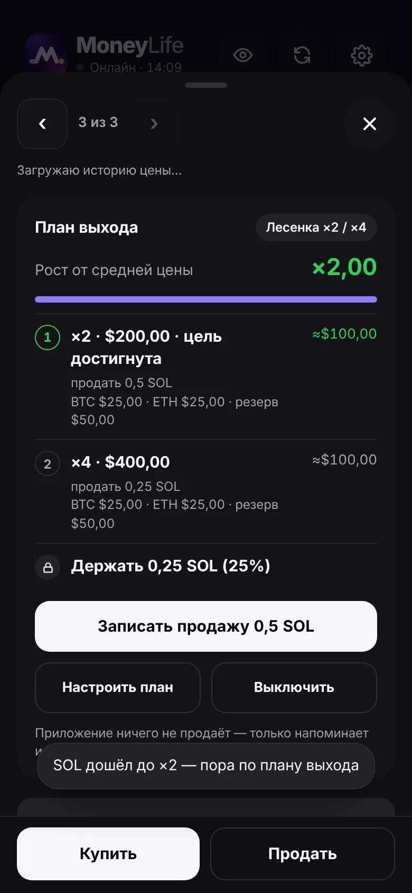 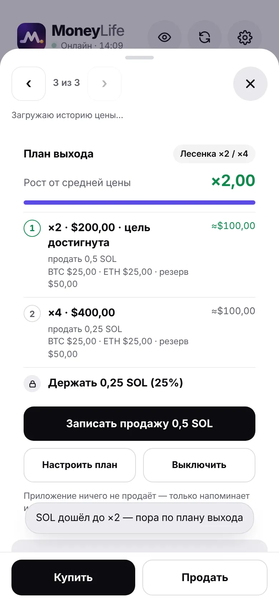 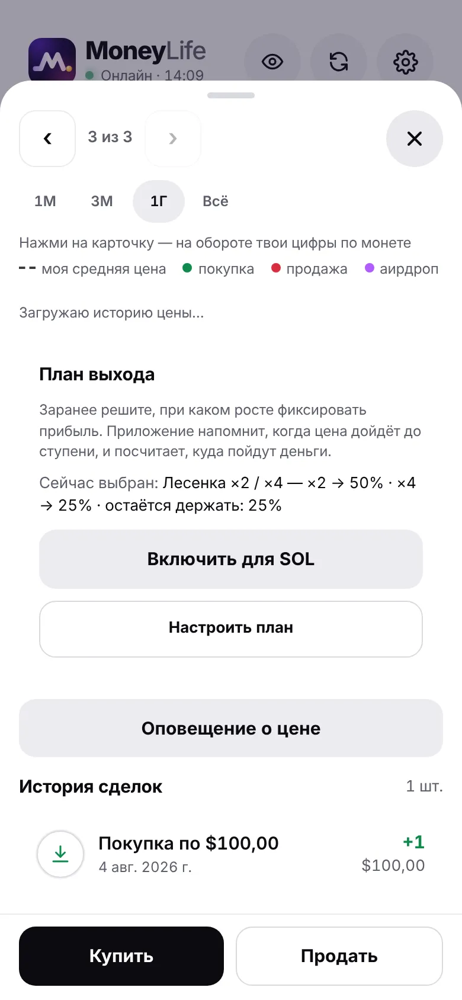 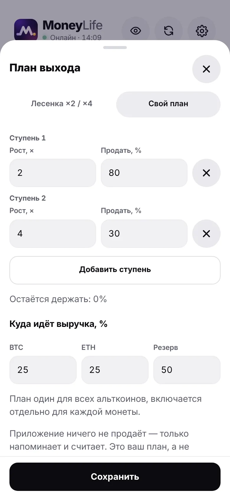
- Пример: купили 22 NEAR по $2,2 → открываете NEAR → «Включить для NEAR» → видите «×2 · $4,40 — продать 11 NEAR, BTC $12,10 · ETH $12,10 · резерв $24,20». Цена дошла до $4,40 — Орион говорит, приходит уведомление, в карточке кнопка «Записать продажу 11 NEAR».
- Данные: новый документ `app/exitplan`; существующие документы и поля не менялись. База (таблицы) не менялась.
- Откат: revert PR; документ `app/exitplan` без модуля ни на что не влияет.

## 26.11.2026 12:30 — Орион замолкает сразу и не заказывает лишний голос (Н5а.1, О.7, Н5а.4)
- Уровень: 🟢 · PR: #27 · Тесты: 821 ✓ · 0 ✗ (до слияния с main) · Ревью: Вера — невидимая правка; свежий Глеб «да»
- Было: после «стоп» / нового вопроса ждавшие заказы голоса уходили в ElevenLabs (лишние символы, до ~2,7 с задержки); нажатие на сферу и сворачивание в паузе между кусками не гасили следующий кусок.
- Стало: ждущие заказы прежнего ответа выбрасываются без запроса; одна общая остановка (субтитр, сфера, сворачивание); не больше 2 запросов одновременно.
- До / после: видимых изменений нет.
- Пример: задаёте длинный вопрос, на втором предложении нажимаете на сферу — голос замолкает, хвост не звучит и не оплачивается.
- Откат: revert PR №27.

## 26.11.2026 12:05 — Мелочи интерфейса: выключенная «›» в Отчёте, контраст Достижений, UK «Рівні сходів», шапка для читалок (В25.5–7, В25.10)
- Уровень: 🟢 · PR: #28 (a067b3c) · Тесты: 833 ✓ · 0 ✗, «Проверки PR» зелёные · Ревью: Вера «да», свежий Глеб «да»
- Было: «›» на текущем месяце выглядела рабочей; неполученные достижения 4,2:1 / 3,1:1; UK «Сходинки сходів»; «Цены на» для читалок через aria-label у span.
- Стало: «›» бледная и не нажимается; контраст 7,0:1 / 6,4:1; «Рівні сходів»; спрятанный текст «Цены на » / «Ціни на » (видимо шапка та же до пикселя).
- До / после: 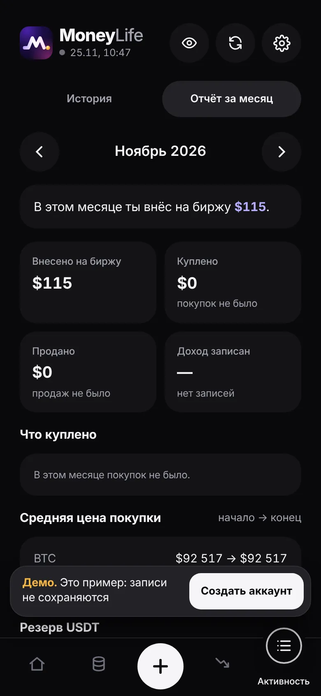  · 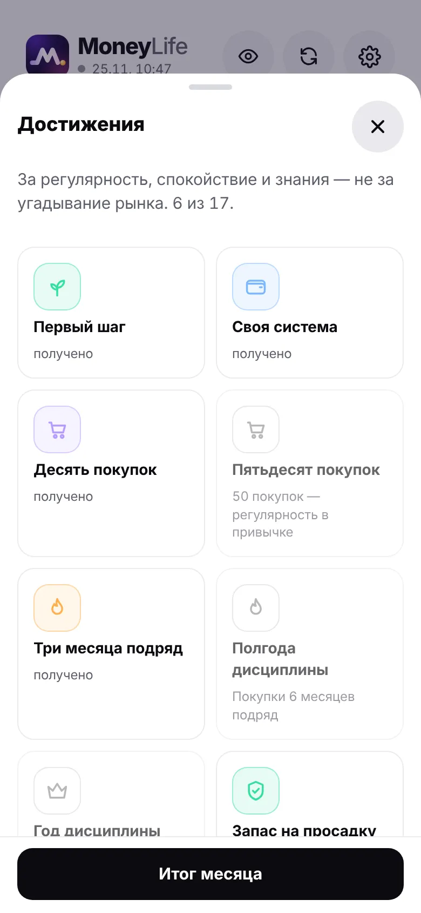 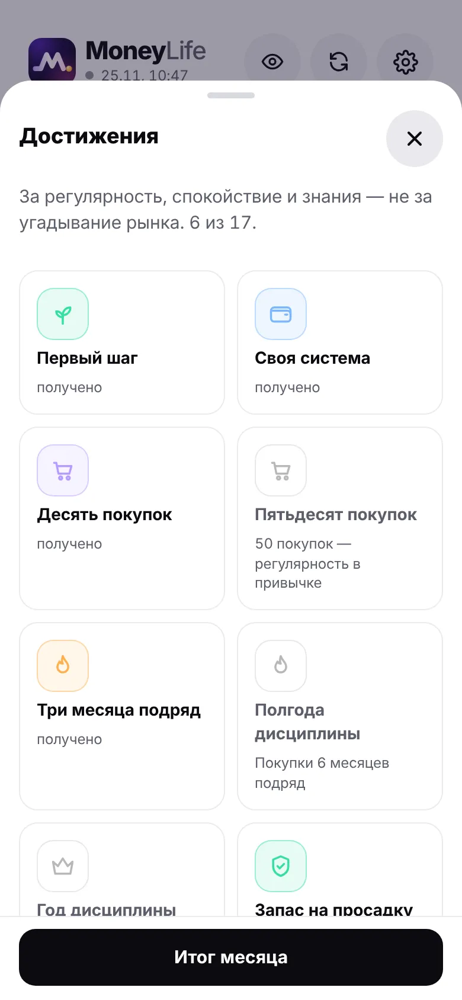 ·  
- Пример: открываете «Достижения» — названия ещё не полученных читаются, но видно, что они не получены.
- Откат: revert PR №28.

## 26.11.2026 04:10 — Вёрстка: количество монет на 360 px, время цен в шапке, кнопки в шторках светлой темы (В25.1–В25.3)
- Уровень: 🟢 · PR: #26 · Тесты: 814 ✓ · 0 ✗ (до слияния с main), после слияния — проверки В25 и Н5а 130 ✓ / 88 ✓, «Проверки PR» — см. PR · Ревью: Вера «да» В25.1/В25.2, «нет» В25.3 (рамка на всех списках шторок) → директор: рамка только у кнопок; свежий Глеб «нет» (цена в гривнах резалась на 371–389 px) → директор: колонки цены/суммы прежние, место — у значка, промежутков и полей, тест «гривны не обрезаны» → свежий Глеб «да»
- Было: на 360 px «BTC 0,002…»; в шапке «Цены на 25 нояб.…»; в светлой теме варианты «Личного плана» и плитки «Новой записи» белые на белом.
- Стало: количество целиком («0,002702»); в шапке «25.11, 10:47» (полная фраза — в подсказке, RU/UA); у этих кнопок тонкая рамка (контраст 3,4:1), списки и тёмная тема без изменений.
- До / после: 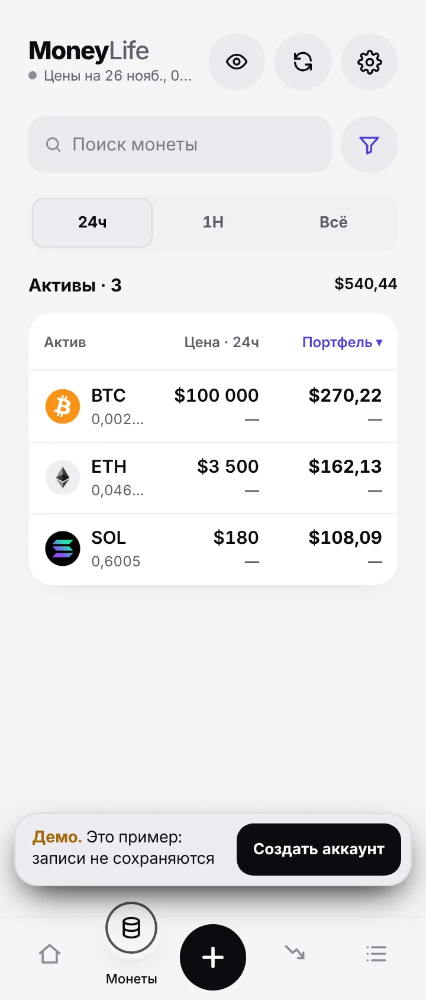 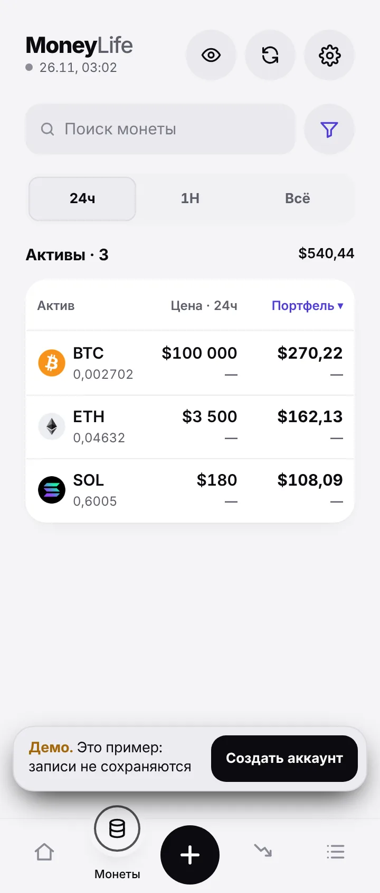 ·  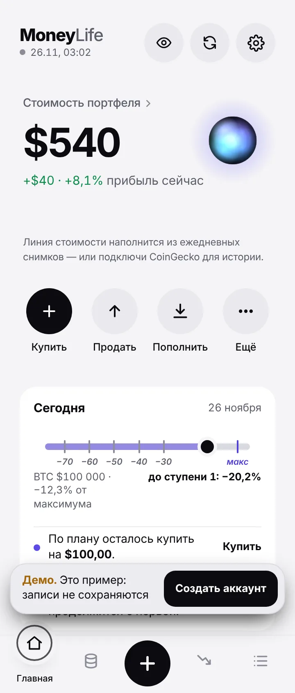 · 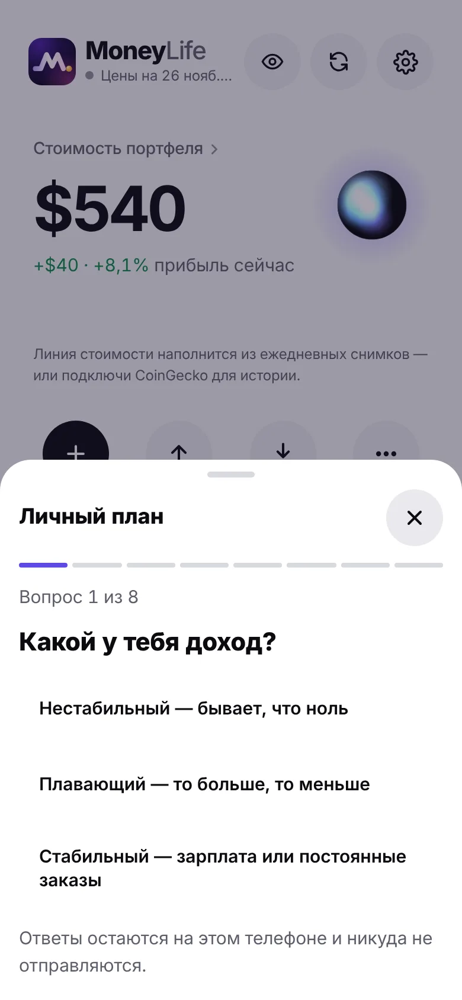 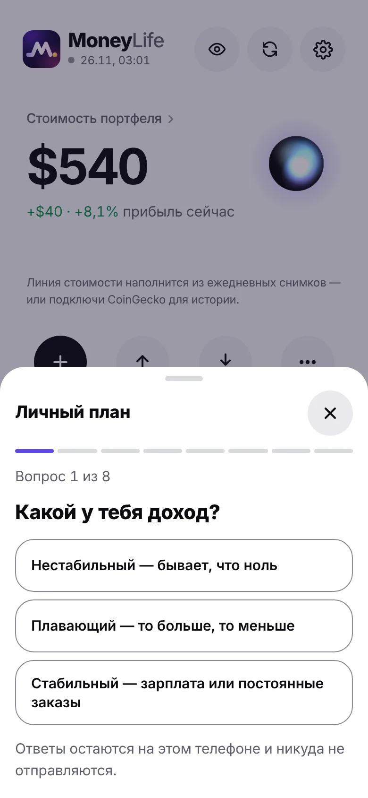 (кадр «Монеты после» — с круга 1, колонки цены там на 2 px уже, вид количества тот же)
- Пример: открываете «Монеты» на телефоне 360 px → видите количество BTC целиком; в шапке — «25.11, 10:47».
- Откат: revert PR №26.

## 26.11.2026 03:55 — Орион быстрее после «Секунду»: субтитры сразу, голос догоняет (Н5а, часть приложения)
- Уровень: 🟢 · PR: #25 (083fb27) · Тесты: 776 ✓ · 0 ✗, «Проверки PR» зелёные · Ревью: Вера «да», свежий Глеб «да» · Сборка сайта: success
- Было: текст ответа ждал звук до 4 с (первый кусок ≥ 60 знаков → озвучка целиком → звук).
- Стало: субтитр сразу (замер 3,51 с → 0,6 с), первый кусок голоса — одно предложение, озвучка следующих кусков заранее; запросов голоса ровно по числу кусков (убран старый лишний).
- Вид экранов не менялся. Пример: спрашиваете «как дела у биткоина?» → «Секунду» → через ~0,6 с читаете ответ, голос следом.
- Не проверено: первое слово ≤ 2 с на живом голосе ElevenLabs — замер на телефоне. Откат: revert PR №25.

## 25.11.2026 22:10 — Орион не удаляет «последнюю / все», если цель названа без «про» (О.5, О.6)
- Уровень: 🟢 · PR: #24 · Тесты: 772 ✓ · 0 ✗, «Проверки PR» зелёные · Ревью: свежий Глеб «да»; Вера «нет» (UK «Удалил:» по-русски) → исправлено директором + вежливые хвосты → свежий Глеб «нет» («отмени напоминание последнее» снимало все — было и раньше) → исправлено директором → свежий Глеб круг 3
- Было: «отмени напоминание на завтра / по квартплате / позвонить маме» снимало **все** напоминания без вопроса; «удали заметку по налогам / купить eth» сразу удаляло **последнюю** заметку.
- Стало: слова после «заметку / напоминание» — это цель: одна подходит — «Удалить заметку «…»?» и удаление только после «да»; ни одной — «Не нашёл…»; несколько — «Какую удалить?». «удали последнюю заметку (пожалуйста)», «отмени все напоминания» — как раньше. UK: «Нотаток немає.», «Скасував.», «Видалив: …».
- Вид экранов не менялся. Пример: говорит «Орион, отмени напоминание по квартплате» → слышит «Отменить напоминание «оплатить квартплату»?» → «да» → снято только оно.
- Откат: revert PR №24.

## 25.11.2026 21:20 — Мониторинг сбоев приложения (И4)
- Уровень: 🟡 · PR: #16 · Тесты: 770 ✓ · 0 ✗, «Проверки PR» зелёные · Ревью: Вера «да», свежий Глеб «да» (24.11); после слияния со свежим main — свежий Глеб «да» (только метки версии)
- Было: об ошибках у людей мы не знали. Стало: ошибки JS без id, почты и сумм попадают в свою таблицу `client_errors` (хранятся до 30 дней, читать может только сервер); строка об этом — в политике RU/UK.
- До / после: 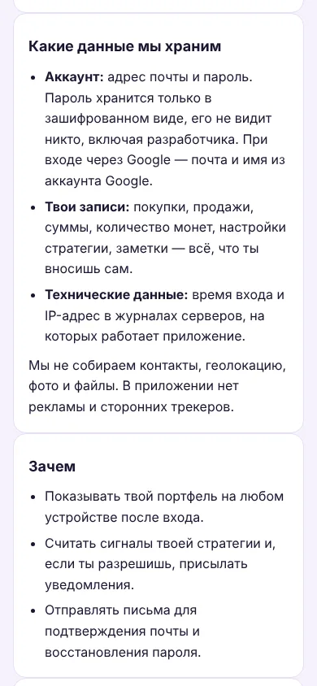 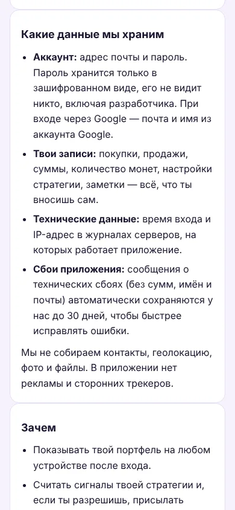
- Миграция применена 25.11 13:35 по просьбе владельца. Откат: revert PR №16; таблица — `supabase/client_errors_rollback.sql`.

## 25.11.2026 12:50 — Орион не делает лишнего: обрыв посреди действия, «о/насчёт», переспрос после «Не нашёл» (Н4.1, Н4.2, О.2, О.3)
- Уровень: 🟢 · PR: #23 · Тесты: 735 ✓ · 0 ✗, «Проверки PR» зелёные · Ревью: свежий Глеб «да» (круг 1) и «да» (круг 2, вся разница); Вера «нет» (UK-промахи по-русски) → «нет» (чужой падеж после «про») → исправлено директором (круг 3)
- Было: обрыв связи посреди «действия» Ориона выполнял его с пустыми данными; «удали заметку о налогах» / «отмени напоминание насчёт банка» удаляли последнюю заметку / снимали все напоминания; после «Не нашёл …» голая «удали заметку» удаляла последнюю сразу; нажатие на субтитр в паузу между кусками не гасило следующий кусок.
- Стало: обрыв посреди действия → «Связь прервалась.», ничего не выполняется (сервер `orion-ask` + приложение); «о / об / обо / насчёт / щодо / стосовно» = «про»; после промаха 2 минуты — переспрос «Удалить …?» (отдельно для заметок и напоминаний), все напоминания разом не снимаются; UK: «Не знайшов нотатку щодо …», «Не знайшов такої нотатки.».
- Вид экранов не менялся. Пример: говорит «Орион, удали заметку о налогах» → исчезает именно «налоги», остальные на месте.
- Серверная функция `orion-ask` развёрнута в Supabase отдельно (после вливания). Откат: revert PR №23 + развернуть `supabase/functions/orion-ask/index.ts` из main до PR.

## 25.11.2026 05:00 — Орион больше не обрывает фразы (Н4, жалоба владельца)
- Уровень: 🟢 · PR: #22 · Тесты: 728 ✓ · 0 ✗, «Проверки PR» зелёные · Ревью: Вера «нет» (длинный субтитр за экраном) → «да»; свежий Глеб «нет» ×2 (обрыв Anthropic отдавал обрывок слова и кэшировал его; «стоп» не гасил хвост) → «да» (круг 3)
- Было: сервер `orion-ask` резал ответ на 600 знаках посреди слова; поток ждали 25 с; при обрыве после первой фразы Орион молчал. Стало: предел 1500 знаков только по концу предложения; обрыв (телефон↔сервер или сервер↔Anthropic) → целые предложения + «Связь прервалась.» (UK «Зв’язок перервався.»), обрывок не кэшируется; длинный ответ — кусками ≤ 380 знаков (субтитр в пределах экрана); поток 45 с; «стоп» гасит и хвост в пути.
- Вид экранов не менялся (субтитр длинного ответа — скриншоты Веры в смене). Формат ответа сервера прежний.
- Пример: говорит «Орион, расскажи подробнее, почему биткоин падает» → слышит ответ целиком, последнее слово — конец предложения; пропал интернет посреди ответа → «…двадцать процентов. Связь прервалась.»
- Серверная функция `orion-ask` развёрнута в Supabase отдельно (после вливания). Откат: revert PR №22 + развернуть `supabase/functions/orion-ask/index.ts` из main до PR.

## 24.11.2026 22:30 — Орион переспрашивает перед удалением заметки или напоминания (BACKLOG №1)
- Уровень: 🟢 · PR: #12 · Тесты: 707 ✓ · 0 ✗, «Проверки PR» зелёные · Ревью: Вера «да» (тексты, «Дела Ориона» UK, 24.11 днём); свежий Глеб — «нет» ×4, затем «да» (круг 5, 35 проб RU/UK)
- Было: «удали заметку про налоги» стирала последнюю заметку, «отмени напоминание про биржу» — все напоминания. Стало: Орион называет запись — «Удалить заметку «оплатить налоги до 15-го»? Скажите «да» или «нет».» — и удаляет ровно её только после «да» в течение 20 с. «нет», «не понял», молчание, другой вопрос — ничего; 2 минуты после вопроса «голые» команды («удали заметку», «отмени напоминания») ничего не снимают; «отмени»/«скасуй» подтверждают только напоминание.
- Пример: говорит «Орион, удали заметку про налоги» → слышит «Удалить заметку «оплатить налоги до 15-го»?» → «да» → «Удалил: «оплатить налоги до 15-го».», остальные заметки на месте.
- Вид экранов не менялся. Откат: revert PR №12.

## 24.11.2026 22:00 — График монеты появляется сразу (Н2)
- Уровень: 🟢 · PR: #21 (f07c1c8) · Тесты: 709 ✓ · 0 ✗, «Проверки PR» зелёные · Ревью: Вера «да» (обе темы, попиксельно), свежий Глеб «да»
- Было: при копии старше часа (6 ч для «1Г») шторка ждала сеть — ~1250 мс. Стало: сохранённая копия сразу (53–81 мс, «3М» 6–11 мс), свежие данные тихо в фоне; через 3 с после запуска графики монет портфеля подгружаются заранее (до 10, только биржи).
- До / после: `09-moneta-dark-390` / `light` — совпадают попиксельно (вид не менялся).
- Пример: открывает приложение → нажимает монету → график сразу, без «Загружаю…»; через секунду дополняется свежими точками.
- Сайт собрался (pages build success). Откат: revert PR №21.

## 24.11.2026 11:40 — «План альткоинов» снова листается (Н3, жалоба владельца)
- Уровень: 🟢 · PR: #19 (d23e784) · Тесты: 695 ✓ · 0 ✗ (ветка), «Проверки PR» зелёные · Ревью: Вера «да» (обе темы, 390), Глеб «да» (сам откатил CSS — новые тесты падают)
- Было: складка растягивалась под все 19 карточек (2272 px вместо 308) — видны только июнь–август, правое и текст под лентой обрезаны. Стало: одна строка CSS `grid-template-columns:minmax(0,1fr)` у `.fold-b`; лента листается внутри карточки, текущий месяц виден сразу.
- До / после: `ai-ops/screens/pr/alt-plan-do-dark-390.webp` → `alt-plan-posle-dark-390.webp` (и light).
- Пример: открывает «Стратегия» → раскрывает «План альткоинов» → видит ноябрь (FIL) → листает до декабря 2027 → текст под лентой читается целиком.
- Сайт собрался (pages build success). Откат: revert PR №19.

## 19.11.2026 03:40 — Ночная резервная копия базы (И3, Этап 2)
- Уровень: 🟡 (новое в базе, privacy.html, delete.html) · PR: #13 (3e05e04) · Тесты: 679 ✓ · 0 ✗ (ветка), «Проверки PR» зелёные · Ревью: Глеб «да» (круг 2), Вера «да» (обе темы, RU/UK, 390/360)
- Было: своей резервной копии базы не было. Стало: раз в сутки (00:17 UTC) копия таблицы `docs` в закрытую схему `moneylife_backup` (RLS, без прав у приложения), копии старше ~5,5 суток стираются сами (≤ 7 дней). Первый снимок вручную: 237 записей = 237 в `docs`; две задачи pg_cron на месте; прав у anon/authenticated нет.
- На страницах «Конфиденциальность» и «Удаление аккаунта» — строка «Резервные копии базы (на случай сбоя) — хранятся не дольше 7 дней и затем удаляются автоматически» (RU/UK).
- Пример: если ошибка испортит записи человека, команда видит копию за вчера и может вернуть недостающее — только по слову владельца.
- Сайт собрался (pages build success). Откат: `supabase/backup_docs_rollback.sql` + revert PR №13.

## 18.11.2026 14:30 — Решения владельца записаны, команда переведена на полную автономию, Этап 2 начат
- Уровень: правила работы · PR: ai-ops/autonomy · Код приложения не менялся.
- PR №9 влит (одобрен владельцем). DECISIONS: вариант Б, «вы» везде, полная автономия, база — только добавление.
- RULES v2: 🟡 делаем сами строже; 🛑 стоп-список (данные, деньги, правила стратегии, сделки); кнопка «стоп».
- Этап 2: И1 — GitHub Actions «Проверки PR» (тесты + скриншоты на каждый PR); И2 — «стоп»; И3–И8 — в BACKLOG первыми.
- Устав команды `agent/AGENT.md`: раздел «Режим с 18.11» — компас `/ai-ops/`; задача «Компания MoneyLife» обновлена.
- Откат: `git revert` этого PR; прежний текст задачи — в истории чата.

## 18.11.2026 — Этап 1, доработка: все экраны и сверка с инструкцией проекта
- Уровень: 🟡 (часть PR №9, ждёт «ок» владельца) · Код приложения не менялся.
- `tools/screens.py`: ещё 9 экранов на 390 px × 2 темы — ролик (обложка и слайд), знакомство, шторка монеты, Личный план, Знания, Достижения, Итог месяца, Орион с субтитрами, украинский язык. Всего 56 скриншотов.
- PRODUCT_VISION 1.1: характер, умения, голос и честность Ориона — из инструкции (юмор Джарвиса вместо «без шуток»); вопрос «что такое MoneyLife» (А/Б/В).
- RULES: раздел «Стандарты разработки» из инструкции (деньги точно, цены из API, безопасность, доступность, проверки перед сдачей).
- BACKLOG 1.1: пункты 16–20 (деньги точно, согласие на живой голос с суммами, «Другие деньги» + макет M6, тексты в файлы перевода, юмор Ориона); №14 — свечение карточки монеты.
- Откат: вернуть файлы `ai-ops/` и `tools/screens.py` к коммиту 04b7062.

## 18.11.2026 — Этап 1: «ДНК продукта»
- Уровень: 🟡 (меняет правила работы — ждёт «ок» владельца) · PR: см. ветку `ai-ops/stage-1` · Код приложения не менялся.
- Создана папка `/ai-ops/`: PRODUCT_VISION, VISUAL_GUIDE, DECISIONS, PREFERENCES, BACKLOG, RULES, CHANGELOG_AI.
- Скриншоты всех основных экранов на демо-данных: 7 экранов × 2 темы × 2 ширины + 4 целиком (`ai-ops/screens/`).
- Скрипт автоскриншотов `tools/screens.py` (без интернета, демо-портфель, webp) — основа для «до/после» на каждый PR.
- 5 макетов к BACKLOG (`ai-ops/mockups/`).
- Откат: удалить папку `ai-ops/` и `tools/screens.py` — приложение они не затрагивают.

## До 18.11.2026 — кратко
- 28.10 — запущена команда ИИ-агентов, смены по расписанию; 03.11 — устав v3 (5 ролей, мелкое выкладывают сами).
- 10.11 — MoneyLife 3.0 и стиль «Графит»; 12.11 — украинский язык, «Достижения», «Складки».
- 14.11 — отпуск владельца: курс на качество, 3 смены в день, «охота на ошибки» ежедневно.
- 15–18.11 — выложено само ~20 мелких исправлений (суммы с минусом, запятая «1,5», «−0», докупка больше резерва и др.);
  17–18.11 — сессии владельца: Орион, этапы 1–5, ролик «MoneyLife за минуту», пуш-уведомления. Тесты 18.11: 666 ✓ · 0 ✗.
